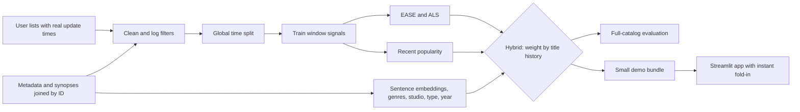

# Hybrid Anime Recommender

A top-10 anime recommender that handles brand-new titles and brand-new visitors. It blends collaborative filtering with synopsis and metadata signals, was evaluated with a global time-based split against the full catalog, and ships as an instant Streamlit demo.

**Demo:** not deployed yet. See [Deploy](#deploy) for the commands.

## Problem

Collaborative filtering cannot rank a title nobody has watched, and popularity lists ignore individual taste. This project ranks every eligible title for each user, shifts smoothly toward content signals as a title's history falls to zero, and folds in new users without retraining.

## Results

<!-- RESULTS:START -->
**The hybrid beats all-time popularity by 312.6% on NDCG@10** (0.1517 vs 0.0368; paired bootstrap 95% CI on the lift +297.7% to +327.0%).

Against the harder recent-popularity baseline (0.0929), the lift is 63.3% (95% CI +60.6% to +66.2%), which is also statistically clear.

Against EASE alone (0.1521), the hybrid scores 0.1517: a difference of -0.0004 (95% CI -0.0009 to +0.0000), so the two are effectively level overall. The hybrid's purpose is reaching titles EASE cannot score at all, not raising overall accuracy.

Cold titles are handled only partly. Ranked among cold titles alone, the hybrid reaches NDCG@10 0.1364 versus 0.0000 for popularity. In full-catalog ranking they take just 0.27% of recommendation slots and NDCG@10 on them is 0.0003, so they rarely reach a user's top 10.

| Model | NDCG@10 | Recall@10 | Precision@10 |
|---|---|---|---|
| Popularity (all-time) | 0.0368 | 0.0362 | 0.0250 |
| Recent popularity | 0.0929 | 0.0963 | 0.0534 |
| EASE | 0.1521 | 0.1521 | 0.0874 |
| ALS | 0.1292 | 0.1300 | 0.0773 |
| Content | 0.0533 | 0.0537 | 0.0343 |
| Hybrid | 0.1517 | 0.1524 | 0.0863 |

| Segment | Users | Popularity | Recent popularity | Hybrid |
|---|---|---|---|---|
| All users | 25193 | 0.0368 | 0.0929 | 0.1517 |
| Users with little history | 101 | 0.1826 | 0.1439 | 0.2013 |
| Warm titles | 25172 | 0.0368 | 0.0931 | 0.1520 |
| Cold titles (full-catalog ranking) | 938 | 0.0000 | 0.0000 | 0.0003 |
| Cold titles (ranked among cold only) | 938 | 0.0000 | 0.0000 | 0.1364 |

Test window 2018-02-01 to 2018-05-01, 25,193 users, 10,720 eligible titles (341 cold). Full details are in [reports/results.md](reports/results.md).
<!-- RESULTS:END -->

## Dataset and license

| Source | Used for | License |
|---|---|---|
| [MyAnimeList Dataset, azathoth42](https://www.kaggle.com/datasets/azathoth42/myanimelist) | Interactions, timestamps, metadata | Open Database License (database), Database Contents License (contents) |
| [MyAnimeList Dataset, svanoo](https://www.kaggle.com/datasets/svanoo/myanimelist-dataset) | Synopses, joined by anime ID | CC0 |

Raw data is not committed; `make data` downloads it from Kaggle's public endpoint without credentials. Usernames are dropped during processing. The ODbL requires attribution and share-alike for derived databases, so check those terms before redistributing the processed data. The demo hotlinks official cover art, which belongs to its rights holders and is not covered by these licenses; review that before deploying publicly, or set `ANIMEREC_SHOW_COVERS=0` for generated art.

## Architecture



## Methodology

- **Task:** top-K implicit-feedback ranking. A positive is a completed title with a score of at least 7 or above the user's training-period mean. Dropped titles are negative signals.
- **Splits:** train before 2017-11-01, validation to 2018-02-01, test to 2018-05-01. Tuning used validation only.
- **Ranking:** every model ranks the full eligible catalog. Titles already in a user's history are excluded, and there is no negative sampling.
- **Leakage controls:** all behavioral inputs come from before the fit cutoff, eligibility comes from metadata only, and crawl-time aggregates such as global score and members are excluded.
- **Models:** all-time and recent popularity, EASE, ALS, a content model, and the hybrid.
- **Hybrid:** per title, `alpha = n / (n + kappa)`, where `n` is the title's training interactions. The score is `alpha * (z(CF) + w * z(recent popularity)) + (1 - alpha) * (z(content) + cold_bias)`.
- **Uncertainty:** paired bootstrap over users for the NDCG@10 difference and lift.

Choices and trade-offs are recorded in [DECISIONS.md](DECISIONS.md). The full report is [reports/results.md](reports/results.md), and generated resume text is in [reports/claims.md](reports/claims.md).

## Limitations

- Timestamps record the last edit of a list entry, so a title re-edited later is missing from earlier history.
- The data ends in May 2018, so the demo's "new" titles are new as of that snapshot.
- Results cover a seeded sample of users from a public-list crawl, which may not represent all viewers.
- Titles with no matched synopsis rely on genre, studio, type and year only.
- Cold titles rarely reach the top 10 in full-catalog ranking, and shows airing during the test window with little earlier history are among the most-missed titles.
- The hybrid is level with plain EASE overall; its added value is being able to score titles with no history.
- Synopses come from a later crawl than the interactions. They describe the title, not its audience, but the text may have been edited after the study window.

## Setup and commands

Requires [uv](https://docs.astral.sh/uv/) (it installs Python 3.11 for you) and about 8 GB of free disk space.

```bash
make setup      # create .venv and install pinned dependencies
make data       # download, clean, EDA, embeddings
make train      # tune on validation, freeze, refit, export artifacts
make evaluate   # score the held-out test window
make report     # write reports/results.md, claims.md, charts
make test       # unit tests
make app        # launch the demo
make all        # tests plus every pipeline stage
```

`make clean` removes derived files and keeps the raw downloads. All settings are in [configs/default.yaml](configs/default.yaml).

## Deploy

The demo needs only `app/`, `src/animerec/` and `artifacts/demo/`, and `app/requirements.txt` holds its small runtime dependency list.

**Streamlit Community Cloud**

```bash
gh repo create anime-recommender --public --source=. --push
```

Then create an app at [share.streamlit.io](https://share.streamlit.io) from that repository, with main file `app/streamlit_app.py` and Python 3.11. Credentials stay in your GitHub and Streamlit accounts.
