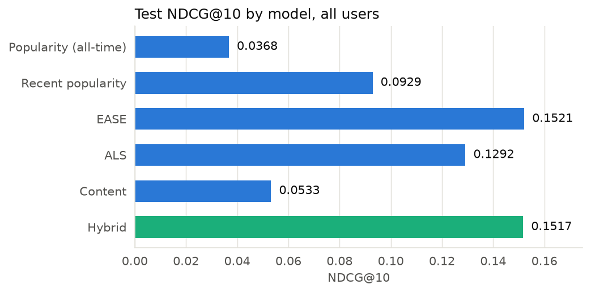
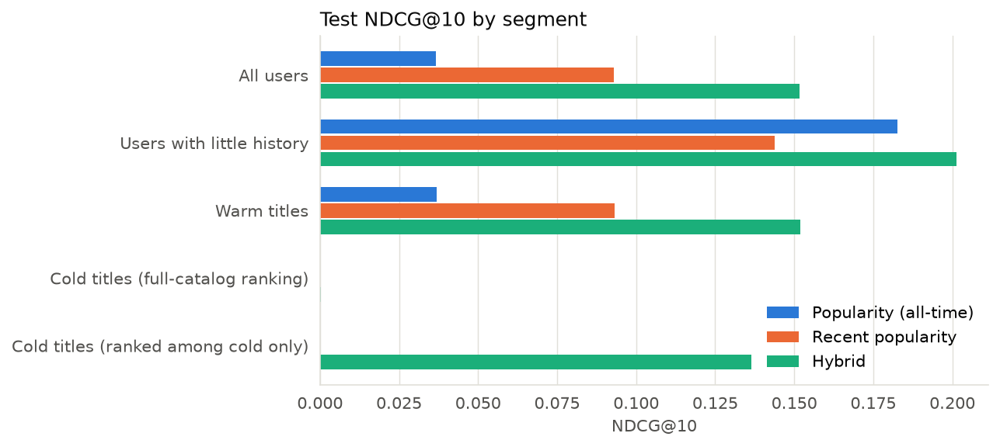
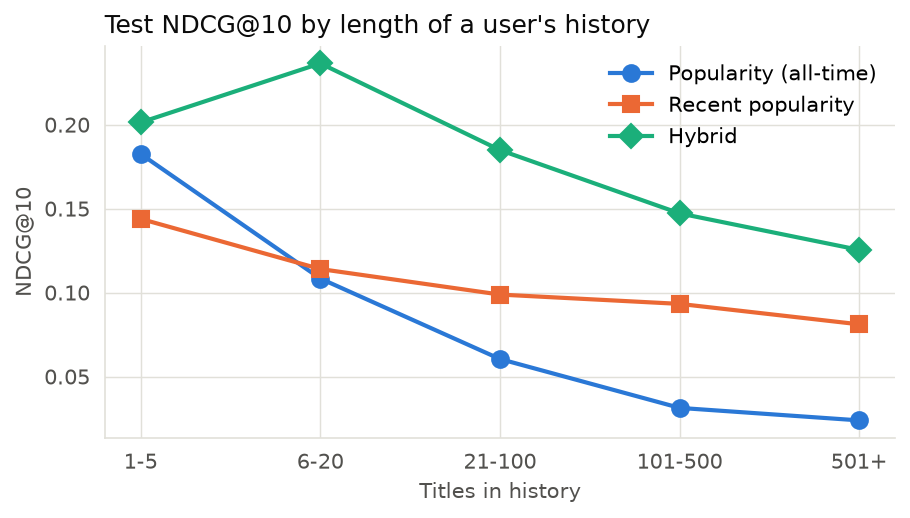
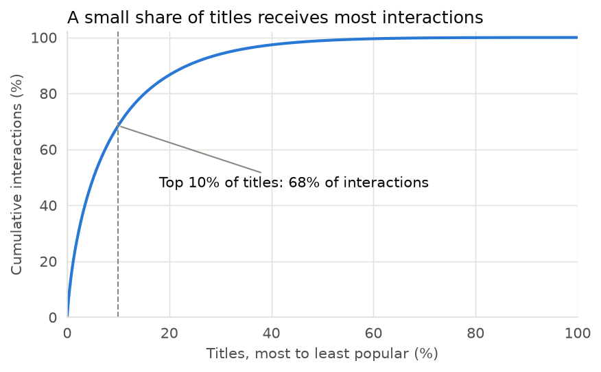
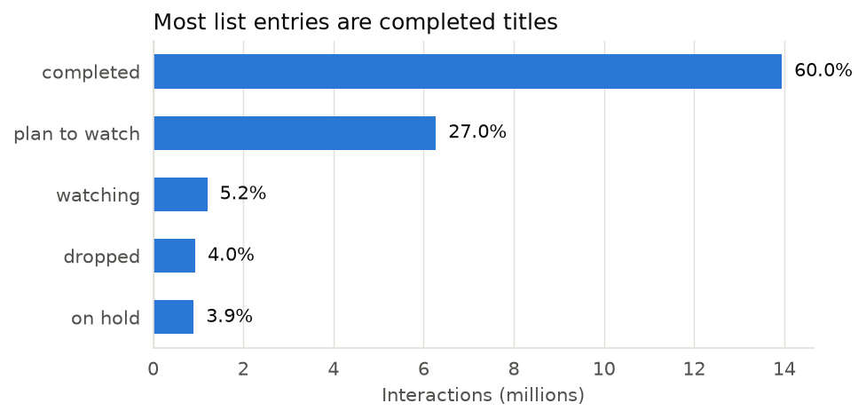
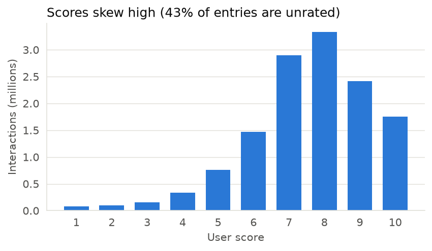
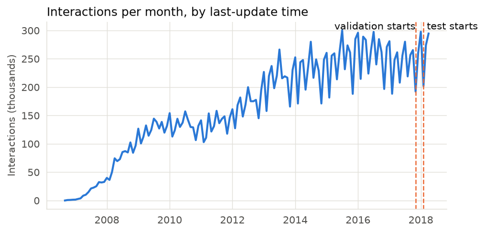

# Results

Generated by `scripts/report.py` from `reports/generated/*.json`. Do not edit by hand.

## Headline

**The hybrid beats all-time popularity by 312.6% on NDCG@10** (0.1517 vs 0.0368; paired bootstrap 95% CI on the lift +297.7% to +327.0%).

Against the harder recent-popularity baseline (0.0929), the lift is 63.3% (95% CI +60.6% to +66.2%), which is also statistically clear.

Against EASE alone (0.1521), the hybrid scores 0.1517: a difference of -0.0004 (95% CI -0.0009 to +0.0000), so the two are effectively level overall. The hybrid's purpose is reaching titles EASE cannot score at all, not raising overall accuracy.

Cold titles are handled only partly. Ranked among cold titles alone, the hybrid reaches NDCG@10 0.1364 versus 0.0000 for popularity. In full-catalog ranking they take just 0.27% of recommendation slots and NDCG@10 on them is 0.0003, so they rarely reach a user's top 10.

X = (hybrid NDCG@10 - popularity NDCG@10) / popularity NDCG@10 x 100 = **312.6%**, using the all-time popularity baseline from the project brief. Recent popularity is the stronger baseline on this data, so read both numbers together.

- Test window: 2018-02-01 to 2018-05-01; models were fit on all activity before 2018-02-01.
- Evaluated users: 25,193. Full eligible catalog: 10,720 titles, including 341 cold titles. No negative sampling.
- Frozen configuration hash: `87fcdde82d0bc3a0`.

## Model comparison (test, all users)

| Model | NDCG@10 | Recall@10 | Precision@10 | Coverage | Diversity | Novelty (bits) | Cold share of slots |
|---|---|---|---|---|---|---|---|
| Popularity (all-time) | 0.0368 | 0.0362 | 0.0250 | 1.9% | 0.6986 | 1.21 | 0.00% |
| Recent popularity | 0.0929 | 0.0963 | 0.0534 | 1.4% | 0.6694 | 3.26 | 0.00% |
| EASE | 0.1521 | 0.1521 | 0.0874 | 10.5% | 0.7015 | 2.85 | 0.02% |
| ALS | 0.1292 | 0.1300 | 0.0773 | 5.1% | 0.6847 | 2.50 | 0.02% |
| Content | 0.0533 | 0.0537 | 0.0343 | 7.8% | 0.5908 | 3.92 | 0.11% |
| Hybrid | 0.1517 | 0.1524 | 0.0863 | 10.1% | 0.7007 | 3.01 | 0.27% |

Coverage is the share of the eligible catalog recommended to at least one user. Diversity is intra-list (1 minus mean pairwise content cosine) and novelty is mean self-information; both use the first 5,000 users.

## Bootstrap confidence intervals over users

Paired resampling of users, 2,000 replicates.

| Segment | Users | vs popularity: NDCG diff [95% CI] | vs popularity: lift [95% CI] | vs recent popularity: NDCG diff [95% CI] | vs recent popularity: lift [95% CI] |
|---|---|---|---|---|---|
| All users | 25193 | +0.1150 [+0.1124, +0.1177] | +312.6% [+297.7%, +327.0%] | +0.0588 [+0.0567, +0.0610] | +63.3% [+60.6%, +66.2%] |
| Users with little history | 101 | +0.0188 [-0.0373, +0.0762] | +10.3% [-18.2%, +50.4%] | +0.0574 [+0.0109, +0.1059] | +39.9% [+6.8%, +83.9%] |
| Warm titles | 25172 | +0.1152 [+0.1124, +0.1178] | +312.7% [+298.5%, +327.8%] | +0.0589 [+0.0568, +0.0611] | +63.3% [+60.3%, +66.3%] |
| Cold titles (full-catalog ranking) | 938 | +0.0003 [+0.0000, +0.0009] | n/a | +0.0003 [+0.0000, +0.0009] | n/a |
| Cold titles (ranked among cold only) | 938 | +0.1364 [+0.1193, +0.1546] | n/a | +0.1364 [+0.1193, +0.1546] | n/a |

## Segment results (test)

Warm and cold rows score only that kind of title as relevant. The "full-catalog" cold row uses the same full ranking as every other row. The "ranked among cold only" row restricts candidates to cold titles, which isolates how well a model orders them.

### All users

| Model | Users | NDCG@10 | Recall@10 | Precision@10 |
|---|---|---|---|---|
| Popularity (all-time) | 25193 | 0.0368 | 0.0362 | 0.0250 |
| Recent popularity | 25193 | 0.0929 | 0.0963 | 0.0534 |
| EASE | 25193 | 0.1521 | 0.1521 | 0.0874 |
| ALS | 25193 | 0.1292 | 0.1300 | 0.0773 |
| Content | 25193 | 0.0533 | 0.0537 | 0.0343 |
| Hybrid | 25193 | 0.1517 | 0.1524 | 0.0863 |
### Users with little history

| Model | Users | NDCG@10 | Recall@10 | Precision@10 |
|---|---|---|---|---|
| Popularity (all-time) | 101 | 0.1826 | 0.0759 | 0.1525 |
| Recent popularity | 101 | 0.1439 | 0.0821 | 0.1040 |
| EASE | 101 | 0.1988 | 0.1174 | 0.1515 |
| ALS | 101 | 0.2007 | 0.1107 | 0.1495 |
| Content | 101 | 0.0941 | 0.0492 | 0.0663 |
| Hybrid | 101 | 0.2013 | 0.1207 | 0.1525 |
### Warm titles

| Model | Users | NDCG@10 | Recall@10 | Precision@10 |
|---|---|---|---|---|
| Popularity (all-time) | 25172 | 0.0368 | 0.0363 | 0.0251 |
| Recent popularity | 25172 | 0.0931 | 0.0965 | 0.0534 |
| EASE | 25172 | 0.1524 | 0.1525 | 0.0874 |
| ALS | 25172 | 0.1294 | 0.1304 | 0.0774 |
| Content | 25172 | 0.0533 | 0.0539 | 0.0343 |
| Hybrid | 25172 | 0.1520 | 0.1528 | 0.0864 |
### Cold titles (full-catalog ranking)

| Model | Users | NDCG@10 | Recall@10 | Precision@10 |
|---|---|---|---|---|
| Popularity (all-time) | 938 | 0.0000 | 0.0000 | 0.0000 |
| Recent popularity | 938 | 0.0000 | 0.0000 | 0.0000 |
| EASE | 938 | 0.0000 | 0.0000 | 0.0000 |
| ALS | 938 | 0.0000 | 0.0000 | 0.0000 |
| Content | 938 | 0.0000 | 0.0000 | 0.0000 |
| Hybrid | 938 | 0.0003 | 0.0011 | 0.0001 |
### Cold titles (ranked among cold only)

| Model | Users | NDCG@10 | Recall@10 | Precision@10 |
|---|---|---|---|---|
| Popularity (all-time) | 938 | 0.0000 | 0.0000 | 0.0000 |
| Recent popularity | 938 | 0.0000 | 0.0000 | 0.0000 |
| EASE | 938 | 0.0000 | 0.0000 | 0.0000 |
| ALS | 938 | 0.0000 | 0.0000 | 0.0000 |
| Content | 938 | 0.1364 | 0.2273 | 0.0257 |
| Hybrid | 938 | 0.1364 | 0.2273 | 0.0257 |

Users with no history before the test window (630) are excluded from "All users" because no model can personalize for them. Their results: hybrid 0.0000, popularity 0.2868, recent popularity 0.1921.

## Validation results (used for all tuning)

| Model | Val NDCG@10 | Val cold-title NDCG@10 |
|---|---|---|
| Popularity (all-time) | 0.0365 | 0.0000 |
| Recent popularity | 0.1194 | 0.0000 |
| EASE | 0.1707 | 0.0000 |
| ALS | 0.1355 | 0.0000 |
| Content | 0.0642 | 0.0011 |
| Hybrid | 0.1723 | 0.0010 |

### Positive-threshold sensitivity (validation)

The models stay fixed; only the definition of a relevant title changes.

| Label definition | Users | Popularity NDCG@10 | Hybrid NDCG@10 | Lift |
|---|---|---|---|---|
| {'threshold': 6, 'use_user_mean': True} | 25809 | 0.0369 | 0.1691 | +358.4% |
| {'threshold': 7, 'use_user_mean': True} | 25426 | 0.0365 | 0.1723 | +372.3% |
| {'threshold': 8, 'use_user_mean': True} | 24420 | 0.0362 | 0.1785 | +393.6% |
| {'threshold': 9, 'use_user_mean': True} | 23585 | 0.0359 | 0.1824 | +408.7% |
| {'threshold': 7, 'use_user_mean': False} | 25353 | 0.0364 | 0.1722 | +373.0% |
| {'any_completed': True} | 28619 | 0.0376 | 0.1615 | +329.4% |

Selected configuration: {'seed': 42, 'label_target': {'threshold': 7, 'use_user_mean': True}, 'recent_days': 180, 'train_target': {'threshold': 9, 'use_user_mean': True}, 'dropped_weight': 0.0, 'decay_days': 365, 'ease_l2': 1000, 'als_iterations': 12, 'als_factors': 16, 'als_regularization': 100, 'als_alpha': 10, 'block_weights': {'text': 0.5, 'genre': 1.0, 'studio': 0.5, 'type': 0.5, 'year': 0.5}, 'content_to_cf_l2': 10, 'hybrid_cf': 'ease', 'hybrid_content': 'content_to_cf', 'hybrid_kappa': 1.0, 'hybrid_cold_bias': 6.0, 'hybrid_pop_weight': 1.0}.

Truncating EASE to 200 neighbors for the demo changes validation NDCG@10 from 0.1723 to 0.1702.

## Failure analysis

- Compared with popularity, the hybrid is better for 44.7% of users, tied for 47.4%, and worse for 7.9%.
- Compared with recent popularity: better for 37.0%, tied for 48.8%, worse for 14.2%.
- Cold titles: 1,102 relevant user-title pairs. Hit rate in the top 10 is 0.10% with a synopsis and 0.00% without one (94 pairs).

### By length of user history

| Titles in history | Users | Popularity | Recent popularity | Hybrid |
|---|---|---|---|---|
| 1-5 | 101 | 0.1826 | 0.1439 | 0.2013 |
| 6-20 | 369 | 0.1084 | 0.1140 | 0.2365 |
| 21-100 | 4154 | 0.0604 | 0.0988 | 0.1849 |
| 101-500 | 16892 | 0.0313 | 0.0933 | 0.1472 |
| 501+ | 3677 | 0.0239 | 0.0811 | 0.1254 |

### Most-missed relevant titles

Titles with the most relevant users who did not get them in their top 10.

| Title | Relevant users | Recommended to those users | Cold |
|---|---|---|---|
| Violet Evergarden | 4458 | 0 | no |
| Overlord II | 3951 | 1 | no |
| Mahoutsukai no Yome | 3242 | 0 | no |
| No Game No Life: Zero | 2661 | 0 | no |
| Yuru Camp△ | 2300 | 0 | no |
| Sora yori mo Tooi Basho | 2222 | 0 | no |
| Dragon Ball Super | 2165 | 0 | no |
| Karakai Jouzu no Takagi-san | 2095 | 0 | no |
| Koi wa Ameagari no You ni | 1841 | 11 | no |
| Death March kara Hajimaru Isekai Kyousoukyoku | 1714 | 34 | no |

## Data quality

- Rejected source: in the newer crawl, 97.0% of 9,819,756 sampled `last_interaction_date` values equal a title's air date or the placeholder 2004-05-11 00:00:00, so that column was not used for the split.
- Catalog titles: 14,478 raw, 12,381 after removing adult titles and music or unknown types.
- Synopsis join by anime ID: 69.3% of titles matched; 67.6% of the final catalog has a usable synopsis.
- Sparsity: 1.88% of the sampled user-title matrix is filled. The top 10% of titles receive 68.5% of interactions.
- Sampled users after cleaning: 100,000 of 252,135; interactions kept: 23,249,017.

| Filter | Users removed | Titles removed | Interactions removed | Users left | Interactions left |
|---|---|---|---|---|---|
| raw | 0 | 0 | 0 | 283,045 | 80,076,112 |
| null_or_unparseable | 0 | 0 | 0 | 283,045 | 80,076,112 |
| placeholder_or_pre_launch_ts | 187 | 0 | 482,508 | 282,858 | 79,593,604 |
| after_study_end | 141 | 185 | 656,168 | 282,717 | 78,937,436 |
| invalid_status | 0 | 0 | 100 | 282,717 | 78,937,336 |
| invalid_score | 0 | 0 | 0 | 282,717 | 78,937,336 |
| duplicate_user_title | 0 | 0 | 0 | 282,717 | 78,937,336 |
| title_not_in_catalog | 788 | 2,061 | 1,992,123 | 281,929 | 76,945,213 |
| activity_before_release | 7 | 0 | 301,564 | 281,922 | 76,643,649 |
| bot_list_too_long | 72 | 37 | 533,258 | 281,850 | 76,110,391 |
| bot_bulk_import | 1,254 | 2 | 740,545 | 280,596 | 75,369,846 |
| bot_flat_scores | 500 | 1 | 211,544 | 280,096 | 75,158,302 |
| bot_binge_rate | 27,961 | 27 | 16,635,980 | 252,135 | 58,522,322 |

Tuning trace: 85 validation runs, stored in `reports/generated/tuning_trace.json`.
